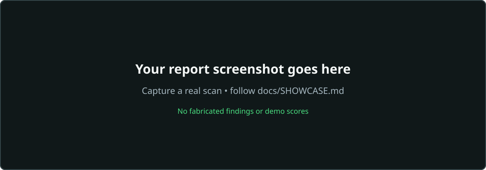
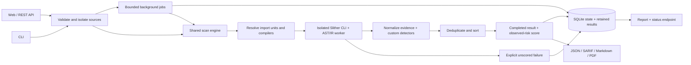

<p align="center"></p>

[](https://github.com/ShkS44D/Contract-Radar/actions/workflows/ci.yml)

[](LICENSE)


**Contract Radar** turns Solidity source into evidence-backed security reports using Slither and a compiler-aware custom detector layer. Upload a contract or ZIP project, inspect exact source locations and concrete fixes, or run the same engine through the REST API and a CI-ready CLI. Failed compilation, timeouts, and engine failures are explicitly **unscored**: absence of analysis can never become a perfect score.

Static analysis is not a replacement for a manual audit. Scores summarize observed findings; they do not certify a contract's safety.

## What ships in v2

- Automatic pragma/import-aware compiler selection with solc-select; per-process versions avoid concurrent scan races.
- Slither's native rules plus 11 custom classes over AST/IR evidence and offset-preserving source analysis.
- Stable finding fingerprints, severity/confidence, exact line ranges, code context, remediation, and applicable SWC/CWE links.
- Deduplicated findings and transparent confidence-weighted scoring with diminishing returns, letter grades, and risk labels.
- Responsive dark/green reports with filters, search, collapsible findings, highlighted lines, metadata, and score breakdowns. The favicon matches the green shield branding.
- JSON, SARIF 2.1.0, Markdown, and paginated PDF exports.
- Background scanning, bounded admission, status polling, UUID report links, SQLite persistence, and retention.
- Safe `.sol`/source-only `.zip` uploads, CSRF, rate limits, strict CSP/security headers, and source cleanup.
- Typed Python package, pinned locks, unit/security/integration tests, CI, and non-root multistage Docker/Compose.

## Preview and verification



Replace this with your own screenshot using [exact capture instructions](docs/SHOWCASE.md). The [generated design reference](docs/design/README.md) is labeled as a reference, not a product screenshot.

Local verification: **108 tests passed, 90.21% scanner coverage**, and **10 real compiler/Slither integrations passed**. Desktop/mobile browser flows and rendered PDF pages were inspected; SARIF passed the official OASIS schema. Docker configuration validates, but **Docker build/runtime could not run because the local Linux daemon was unavailable**. GitHub Actions awaits its first remote run. See [verification evidence and limits](docs/VERIFICATION.md).

## Quick start: Docker

Requires Docker Desktop's Linux engine (or Docker Engine + Compose) and outbound HTTPS for the initial build.

```sh
docker compose up
```

Open **http://localhost:5000**. The first build installs Slither and compilers **0.8.30, 0.8.20, and 0.7.6**. Compose binds to loopback, runs as UID 10001, drops capabilities, uses a read-only root filesystem, and limits memory/CPU/processes. A private signing secret is generated in the data volume unless `SECRET_KEY` is supplied. Reports and compiler cache use separate volumes; source is temporary.

```sh
docker compose up --build        # rebuild after source changes
docker compose logs -f contract-radar
docker compose down             # stop; report data remains in its volume
```

Set `CONTRACT_RADAR_OFFLINE=true` to disable compiler downloads. Other pragma ranges may need compilers outside the preinstalled set. Container runtime controls remain unverified locally; CI includes an actual build/smoke test.

## Quick start: local Python

Use Python 3.11 or 3.12 and keep the venv outside the repository.

Linux/macOS:

```sh
python3 -m venv ~/.virtualenvs/contract-radar
source ~/.virtualenvs/contract-radar/bin/activate
python -m pip install -r requirements-dev.lock
python -m pip install --no-deps -e .
cp .env.example .env
python app.py
```

Windows PowerShell (no activation-policy changes required):

```powershell
python -m venv "$env:LOCALAPPDATA\ContractRadar\venv"
$radarPython = "$env:LOCALAPPDATA\ContractRadar\venv\Scripts\python.exe"
& $radarPython -m pip install -r requirements-dev.lock
& $radarPython -m pip install --no-deps -e .
Copy-Item .env.example .env
& $radarPython app.py
```

The development server binds to `127.0.0.1:5000`, with debug disabled by default. First-use compiler installation needs HTTPS; installation and the whole scan have deadlines. Activated environments use their own `.solc-select` cache; otherwise the cache is in the user's home directory. Old compiler binaries vary by OS. Docker's Linux target is the preferred deployment path.

## Usage

### Web

Choose a `.sol` file or `.zip` containing Solidity files/directories only, initiate a scan, and wait for the loading page to finish. Review confidence, exact source evidence, remediation, and the score breakdown. Export a report or keep its UUID URL until expiry. Failed scans show diagnostics and no score.

ZIPs preserve relative paths. Include dependency source at the paths your imports use. Framework scripts, automatic npm installs, and fetching external dependencies are not supported.

### API

```sh
curl -F contract=@samples/TxOrigin.sol http://localhost:5000/api/v1/scan
curl http://localhost:5000/api/v1/scan/REPLACE_WITH_RETURNED_UUID
```

POST returns **202**, `scan_id`, `status_url`, and `report_url`. Poll GET every two seconds until terminal `state`: `completed`, `compile_error`, `timeout`, or `engine_error`. Score/grade/risk are null for every failed or unfinished scan. Unknown/expired reports return 404. No cookie authentication/CORS allowance is provided; foreign browser origins are rejected.

OpenAPI: **[/api/v1/openapi.json](http://localhost:5000/api/v1/openapi.json)**. [API contract and exports](docs/API.md).

### CLI and CI

```sh
contract-radar scan samples/TxOrigin.sol --format json
contract-radar scan samples/TxOrigin.sol --format sarif --output contract_radar.sarif --fail-on high
contract-radar scan path/to/project.zip --format md
contract-radar scan path/to/source-directory --format json
```

Equivalent: `python -m contract_radar.cli scan ...`. On Windows without activation, use `& $radarPython -m contract_radar.cli scan ...`.

Exit codes: **0** completed below the selected threshold; **1** completed with a finding at/above `--fail-on`; **2** invalid input, compilation failure, timeout, or engine failure. Output still contains the result when a threshold fails.

To use GitHub code scanning, upload CLI-produced SARIF with `github/codeql-action/upload-sarif` in your workflow and grant that job `security-events: write`. Engine failures must fail CI; do not hide exit code 2. This repository's CI validates the tool/samples without publishing its educational findings as alerts.

## Architecture



`contract_radar/scanner` is framework-independent. Services own uploads/jobs/persistence/export; blueprints own web/API transport. Typed dataclasses define boundaries. Native CLI output and semantic facts currently require two compilation passes per unit. Deployment uses one application process with a bounded pool; a lock protects its data directory.

Read [ARCHITECTURE](docs/ARCHITECTURE.md), [baseline ANALYSIS](docs/ANALYSIS.md), [DETECTORS](docs/DETECTORS.md), and [HARDENING](docs/HARDENING.md).

## Detector registry

Slither's native detector set runs in addition to these custom rules.

| ID | Severity | Description | SWC |
|---|---|---|---|
| SS-001 | Medium | Externally reachable mint/supply capability | — |
| SS-002 | High | Selfdestruct operation with EIP-6780 context | 106 |
| SS-003 | Medium | Mutable blacklist/blocklist used by conditions | — |
| SS-004 | Info | Pause state used to gate execution | — |
| SS-005 | Medium | Owner-controlled fee/tax state | — |
| SS-006 | High | tx.origin in a sensitive condition | 115 |
| SS-007 | Medium | Delegatecall trust boundary | 112 |
| SS-008 | Medium | Unused low-level call return value | 104 |
| SS-009 | Medium | Sensitive owner powers beyond specific capability rules | — |
| SS-010 | High | Ownership mutation outside conventional APIs | — |
| SS-011 | Low | Pragma permits legacy pre-0.8 compilation | 102 |

Capabilities are not automatically exploits. Caps, roles, governance, pause recovery, and upgrades need manual review. SWC references are historical IDs, not a complete modern audit checklist. CWE mappings are supplied only where applicable. [Evidence and confidence limits](docs/DETECTORS.md).

## Transparent scoring

Formula **1.0**, completed scans only:

| Severity | Critical | High | Medium | Low | Info | Gas |
|---|---|---|---|---|---|---|
| Weight | 35 | 22 | 10 | 4 | 0 | 0 |

Confidence multipliers: high **1.0**, medium **0.75**, low **0.5**. Deduplicate, group by canonical rule ID, and sort weighted instances descending:

```text
group_penalty = min(1.5 × maximum_severity_weight,
                    sum(weighted_instance_i / sqrt(i)))    # i starts at 1
score = clamp(round(100 - min(100, sum(group_penalties))), 0, 100)
```

Group penalties round to four decimals. Grades: **A ≥90, B ≥80, C ≥70, D ≥60, F <60**. Risk bands are Low/Moderate/Elevated/High/Very high; a high finding imposes at least High risk, and a critical finding forces Critical risk. Grade stays numeric, so material findings remain visible despite a favorable score.

One high/high-confidence finding deducts 22 points; repeated instances of that rule deduct at most 33. Distinct issue types can still reduce the score to zero. Read the report breakdown and [complete formula](docs/SCORING.md).

## Samples and extending detectors

[Eight educational contracts](samples/README.md) cover reentrancy, tx.origin, unchecked calls, selfdestruct, owner controls, precision loss, ownership/delegatecall, and a clean counter. [Expected findings](samples/expected.json) define required/forbidden rules for the pinned engine. Never deploy the vulnerable samples.

To add a detector:

1. Subclass `Detector`; declare stable metadata and implement a predicate over AST/IR facts.
2. Register it in `DETECTORS`; curate taxonomy/equivalence mappings only when justified.
3. Add positive/negative tests, exact-location assertions, and a real compiler sample.
4. Update docs and expected findings. Avoid substring checks or claims unsupported by evidence.

## Development

```sh
make install
make run
make test
make lint
make format
make integration
make lock
```

Without Make, use commands in [CONTRIBUTING](CONTRIBUTING.md). CI checks Python 3.11/3.12, Ruff, mypy, coverage, real samples, Docker build/health, and a safe CLI scan. Lock regeneration: `python scripts/lock.py`; review dependency and expected-result changes together.

The package is `contract_radar`, the command is `contract-radar`, and configuration uses `CONTRACT_RADAR_*`. Existing installations should reinstall the package and update environment variable names. Set `CONTRACT_RADAR_DATA_DIR` to your existing data directory to retain local reports. Stable detector IDs (`SS-001` through `SS-011`) remain unchanged.

## Configuration and security

Copy `.env.example` to `.env`; real secrets/generated state are ignored. Defaults: 120-second scan/install limits, 2 workers + 4 queued jobs, 24-hour retention, 2 MiB requests/per-source, 8 MiB expanded ZIPs, 50 files, and 10 scan submissions/minute/client. Production disables debug and requires a secret; Compose provisions one privately.

Sources are deleted before terminal results are published. Cleanup errors are explicit and unscored. Reports contain bounded snippets; UUID URLs are bearer access, so keep links private. Retention deletes database results, not backups. Use HTTPS/secure cookies for remote serving. [SECURITY](SECURITY.md) and [HARDENING](docs/HARDENING.md).

## Limitations and roadmap

- Static analysis has false positives/negatives. Custom capabilities do not prove authorization correctness, bounds, or absence of concealed backdoors.
- Compiler catalog is bounded to 0.4.11–0.8.30. Old OS binaries, assembly, unusual builds, and complex roles/inheritance may need manual handling. Incompatible imported pragmas fail clearly.
- No automatic dependency fetching, uploaded framework scripts, on-chain verification, symbolic execution, or exploit simulation.
- One app process; no distributed durable queue, authentication, or public multi-tenant isolation. Non-root Docker is not a complete hostile-code sandbox.
- Two compilation passes per unit. PDF uses portable fonts and explicit escapes for non-ASCII source; JSON/Markdown/web retain UTF-8.
- Docker/remote CI need the remaining checks above. ARM64 container/compiler support is unverified.

Roadmap: reuse one compilation artifact, expand reviewed compiler support, strengthen role/bounds/dataflow predicates, add durable workers/authenticated reports, and benchmark against audited-contract corpora. Ship these with reproducible tests.

## Contributing and license

[CONTRIBUTING](CONTRIBUTING.md) · [CHANGELOG](CHANGELOG.md) · [MIT license](LICENSE). Maintained by S44D.

## Author

Developed by **Muhammad Saad Ahmed (S44D)**, Cybersecurity & Web3 Security Researcher. [LinkedIn](https://www.linkedin.com/in/shsaadahmed/).

