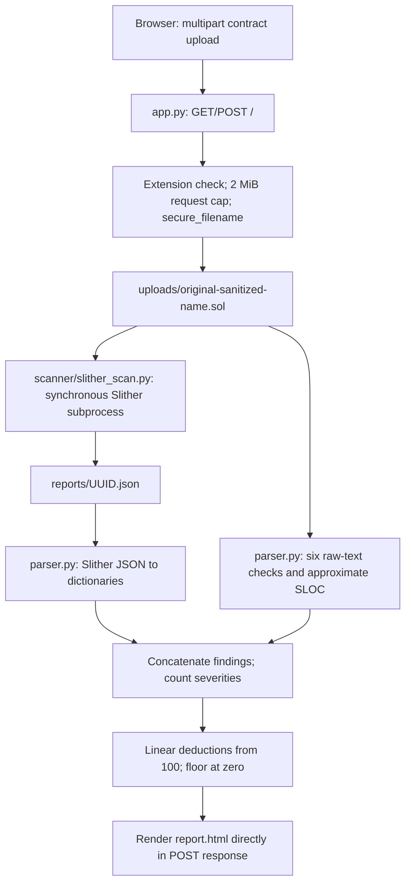

# Solidity Sentinel: baseline analysis and v2.0.0 rebuild plan

Date: 2026-10-12. Status: approved baseline analysis, retained as the v1 snapshot. The rebuild and verification are recorded in CHANGELOG.md and docs/VERIFICATION.md.

## 1. Scope and evidence

Read every tracked file: `app.py`, both scanner modules, both templates, CSS, favicon, README, requirements, ignore rules, and the three-page project proposal PDF. Also read the two local ignored Solidity uploads. Excluded `venv/`, all `__pycache__/`, Git internals, and `reports/*.json` as requested. No applicable AGENTS.md was found in the workspace or checked ancestor directories. No implementation files were changed.

The repository has one commit (`b83547a`, initial v1 release). There are no tests, CI, package configuration, Docker files, license, or existing technical docs. `venv/` exists locally and is **untracked**, not committed; uploads and reports are ignored and not tracked. The root PDF is tracked and is a historical proposal, not implementation documentation. Keep it as `docs/project-proposal.pdf` during the approved cleanup. The favicon and most UI accents are red, with green used for positive status. The requested v2 green accent is a deliberate design change; preserve the shield identity and favicon design.

Python 3.12.10 and Flask are available. Commands named Slither, solc, solc-select, and Docker are discoverable; actual compiler execution and Docker daemon availability have not been verified. No real Slither scan, browser interaction test, or Docker build was performed in this analysis phase.

Read-only probes used a temporary directory outside the repository and disabled Python bytecode generation:

- `parse_report()` on a nonexistent path returned `[]`; scoring an empty summary returned `100`.
- A Solidity probe containing mint/selfdestruct/blacklist in a comment, pausable/tax in a string, and `coffee` produced five custom finding titles.
- An invalid-extension POST returned a silent 302 redirect. CSP, X-Frame-Options, and X-Content-Type-Options were absent from that response.

## 2. Current architecture and data flow

`app.py` constructs Flask globally, creates a working-directory-relative upload folder at import time, and owns validation, orchestration, aggregation, timing, scoring, and rendering. The only route is `/`. Uploads must use the `contract` field and end in `.sol`; the total HTTP request has a 2 MiB cap. Accepted files retain their sanitized user filename.

`run_slither()` creates a UUID report path and invokes an argument-list subprocess with captured output. It ignores the returned exit code and captured streams, then returns the expected path regardless of success. There is no compiler selection or timeout.

`parse_report()` returns no findings if the report is absent. Otherwise it reads `results.detectors`, maps impact strings, strips some description text, and takes the first source element's first line. `analyze_threats()` separately scans the raw upload for mint, selfdestruct, blacklist, old pragma, pausable, and fee words; it produces status cards and additional findings. The two outputs are concatenated without sorting or deduplication.

Scoring deducts 30/15/10/5/2/1 for critical/high/medium/low/info/gas findings respectively. The report shows that score, counts, filename, elapsed wall time, approximate SLOC, finding descriptions/locations, and six threat cards. There is no saved normalized report, report URL, export, API, CLI, job state, or background processing.

## 3. Weaknesses found

### A. Result integrity and engine reliability

1. **Critical: failures can look clean.** Missing report files become zero Slither findings. JSON `success` and `error` are never checked. Custom checks may also return nothing, causing 100/100 after an unsuccessful scan. A failed scan must have no score or grade.
2. Exit codes and stderr are discarded. Missing executables raise unhandled exceptions; malformed JSON, invalid UTF-8 JSON, invalid types, and report I/O errors can produce server errors. `impact: null` also breaks `map_severity()`.
3. Custom analysis catches every exception and silently returns empty outputs, hiding decoding failures and programming errors.
4. No subprocess timeout or process-tree cleanup exists. Compilation can consume a request worker indefinitely. Capturing unlimited output can exhaust memory; there are no CPU, memory, process, or queue limits.
5. No compiler detection, installation, pinning, version metadata, or multi-pragma policy. The installed ambient compiler decides whether a contract compiles. Imports and dependencies have no explicit handling.
6. Global working-directory-relative paths break when launched outside the project root. Reports contain raw engine data but cannot be retrieved through the application.
7. Two uploads with the same sanitized name can overwrite one another while scanning. Sanitization may also collapse different names to the same path or an empty basename.
8. There is no job lifecycle, completion integrity validation, partial-result policy, or atomic normalized-result persistence.

### B. Detection accuracy and report fidelity

1. Raw-text checks match comments, string literals, unrelated identifiers, and imports. `fee|tax|deduction` matches `coffee`, `feed`, and longer words. Mint matching also matches names beginning with `mint` and misses formatting/case nuances and inherited behavior.
2. Presence is treated as exploitability: mint does not establish unlimited supply or owner control; blacklist does not establish effective transfer restriction; pause can be a safety mechanism; fee words do not prove fee changes. Negative cards claim owners cannot blacklist or set fees without sufficient evidence.
3. `selfdestruct` is always called critical and described as destroying the contract. Actual behavior depends on EVM fork and creation-transaction context; access control and reachable execution matter.
4. Old-pragma regex can match comments, interprets range bounds poorly, and can misread longer numeric versions. Absence of a match does not prove use of a modern compiler.
5. SLOC skips lines beginning with comment markers, but miscounts multiline comment bodies, mixed code/comments, closing delimiters, and strings. It is not a lexical SLOC counter.
6. Custom findings have no exact source locations; every detector emits at most one global finding regardless of occurrences. Slither findings lose full relative paths and line ranges, so same-named files would be ambiguous.
7. Findings lack stable rule/instance IDs, confidence, taxonomy links, source snippets, remediation, structured explanations, and engine provenance. Unknown severities quietly become info.
8. Concatenation duplicates overlapping Slither/custom findings and penalizes them twice. No severity ordering or semantic merge exists.
9. No custom detection for tx.origin authorization, delegatecall, unchecked low-level return values, hidden ownership changes, or excessive privileged powers. Slither may cover some of these, but the application has no coverage contract or fixtures.
10. Sample upload comments make claims that are not verified: an unchecked block alone does not guarantee a particular Slither overflow finding. Expected results must be established against pinned engines rather than copied from comments.

### C. App security and operations

1. `debug=True` is hardcoded when started through the documented command. Flask's development server and debugger are unsuitable for production.
2. Extension checking and filename sanitization are useful existing safeguards; there is no content validation. Binary bytes renamed `.sol` are accepted. No explicit empty-file or decoding checks exist.
3. No CSRF protection, request rate limiting, bounded scan concurrency, or admission control. A small upload can still be expensive to compile.
4. Uploads and reports persist indefinitely; there is no cleanup, disk quota, retention, or deletion after exceptions. Source code may contain confidential material.
5. Security headers are absent. External fonts and Font Awesome depend on third-party services; no integrity pinning or CSP exists. Inline scripts/styles complicate a strict CSP.
6. No explicit scanner privilege boundary, sandbox, network policy, read-only filesystem, resource budget, or server-secret separation. Argument-list execution avoids shell injection, but does not isolate compiler vulnerabilities.
7. No structured logging, correlation ID, health/readiness endpoints, sanitized error handling, or documented deployment procedure.
8. Jinja autoescaping and DOM `textContent` are currently used; **no demonstrated template XSS was found**. Preserve these safeguards for future snippets and exports. Do not introduce `safe` rendering of uploaded source.
9. HTTP size failures use Flask's default error page; invalid uploads silently redirect. There is no actionable validation feedback.

### D. Scoring and user experience

1. Linear per-instance deductions reward missed analysis, ignore confidence and duplicates, and can let many minor findings overwhelm material risk. Thresholds are undocumented, with no breakdown or letter grade.
2. The score is called a security score without explaining analyzed scope or uncertainty. No findings is not evidence of audited safety.
3. Long scans block the upload request. Refreshing the POST can resubmit and rescan. No progress, stable URL, loading page, failure page, or expired-report page.
4. Drag-and-drop is advertised but no dragover/drop listeners implement it.
5. The file input is absolutely positioned across width/height 100%, but the upload box has no positioning context; the invisible input can cover unrelated controls.
6. No viewport meta tag. The mobile rule targets nonexistent `.dashboard-grid`; actual dashboard and threat grids remain multicolumn. Metadata and finding headers can overflow.
7. Clickable severity divs lack keyboard button semantics and pressed state. The file input lacks an explicit accessible label; animation lacks reduced-motion handling; muted text can be hard to read.
8. No search, collapsible detail, highlighted snippets, remediation, compiler/engine versions, contract/function counts, exports, or API/CLI entry points.
9. The branding pitch overstates maturity. The proposal includes paste-code support and planned capabilities that do not exist; distinguish proposals from shipped functionality.

### E. Engineering and repository quality

1. Untyped dictionaries/tuples and cross-layer logic make result invariants fragile. No app factory, blueprints, service boundary, dependency injection, docstrings, or consistent configuration.
2. Unused imports and exception variables, compressed one-line conditionals, magic weights, and misleading comments weaken maintainability.
3. Dependencies are unpinned; xhtml2pdf is unused; solc-select is declared but not integrated. No package metadata or reproducible resolution exists.
4. No unit/integration/security tests, coverage checks, lint/format/type checks, CI, or Docker validation.
5. `.gitignore` omits venv and common tooling/build caches. The untracked venv is easy to commit accidentally. Do not assume it is in Git history or delete it during analysis.
6. README installation instructions lack code blocks, compiler setup, requirements, production guidance, examples, limitations, scoring explanation, and contribution instructions. No explicit open-source license exists.

## 4. Rebuild decisions

### Shared model and package

Use a `sentinel` package, Flask app factory, web/API blueprints, independent scanner package, and services for uploads, jobs, storage, and exports. Use typed dataclasses/enums with explicit JSON serialization. A Finding has a rule ID and deterministic instance fingerprint, severity/confidence, provenance, optional applicable SWC/CWE identifiers, relative source path/range, snippet, explanation, and remediation. A ScanResult owns state, metadata, diagnostics, findings, and an optional scoring breakdown.

Invariant: only a successfully validated completed result may contain score/grade/risk. Public queued/running states are separate from terminal `completed`, `compile_error`, `timeout`, and `engine_error`. Validation failures return HTTP errors before creating scans. CLI, API, web, and exports consume the same models, preventing divergent results.

### Compiler and execution

Mask comments/strings while preserving offsets/newlines before reading pragmas. Resolve the intersection of supported stable pragma constraints across each import compilation unit; select a deterministic compatible version from an approved release catalog. Support exact, caret, comparison, conjunction, and OR ranges with tests; reject unsupported syntax clearly. Missing pragmas use a documented configured default with a visible warning. Disjoint independent units may use different versions; incompatible imported ranges fail with diagnostics. Metadata records per-unit compiler versions.

Install through solc-select with bounded download time and a lock around shared cache installation. Set `SOLC_VERSION` per child process instead of changing global selection, avoiding cross-scan races. Preinstall common pinned compilers in Docker and expose an offline mode. Limit supported versions explicitly rather than promising every historical compiler on every platform.

Run Slither in a dedicated subprocess with arguments, fixed working directory, bounded diagnostics, deadline, and process-tree termination. Validate both JSON success/schema and process outcome; distinguish expected finding-related exit behavior from compilation/engine failure. Obtain version metadata and AST-derived analysis in the worker. Use only source/explicit remappings from validated archives; never execute uploaded Hardhat/Foundry scripts, package installers, or arbitrary framework configs. Missing external imports receive a clear compile error, not automatic dependency installation.

### Detectors

Each custom detector is a separate documented class. Use lexical masking for robust source coordinates and pragma checks; prefer Slither AST/IR for access control, function reachability, storage writes, call targets, and return-value checks. Pure word boundaries cannot reliably analyze camelCase setters or control flow. AST evidence must drive mint/blacklist/pause/fee/ownership findings; unresolved cases use conservative confidence and capability language.

Cover mint, selfdestruct, blacklist/blocklist, pause, owner fee/tax control, sensitive onlyOwner powers, tx.origin authentication, delegatecall, unchecked low-level calls, hidden ownership changes, and old compiler constraints. Arbitrary names or onlyOwner alone are not vulnerabilities. Do not promise exhaustive hidden-backdoor detection. Delegatecall use and capped minting require context. Separate informational capabilities from demonstrated risks. Explain modern selfdestruct behavior accurately.

Deduplicate deterministic same-rule/same-location instances; merge known equivalent Slither/custom rules with retained provenance. Preserve unrelated findings and distinct source occurrences. Sort deterministically by severity, confidence, path, and location. Taxonomy mappings are curated and optional: never invent SWC/CWE coverage for centralization capabilities.

### Proposed transparent scoring model

Only completed scans are scored. Deduplicate first. Severity weights: critical 35, high 22, medium 10, low 4, info 0, gas 0. Confidence factors: high 1.0, medium 0.75, low 0.5. Group by canonical issue type; sort weighted instances descending. Group penalty is `min(1.5 * severity_weight, sum(weighted_instance_i / sqrt(i)))`, using one-based i. Total penalty is capped at 100; score is `round(100 - penalty)` clamped to 0..100. Mixed-severity groups use the maximum severity weight for their cap.

Grades: A >=90, B >=80, C >=70, D >=60, F <60. Score-derived labels: low/moderate/elevated/high/very high over the same bands. A critical or high finding additionally imposes a visible minimum critical/high risk label, regardless of grade. Document that grade measures weighted observed findings, not audit assurance. Display each group's contributions and caps. Tests cover bounds, ordering, confidence, repeated types, duplicate removal, and failed-result rejection.

### Web, API, CLI, exports, and job storage

Keep upload `.sol` -> report as the default flow; add validated `.zip` projects. Use a bounded thread pool for local orchestration, with actual analysis in subprocesses, and SQLite for persistent normalized results/status. Deploy the initial service with a single app process and a documented pool limit; recover abandoned jobs after restart. This avoids introducing Redis/Celery before it is needed. Horizontal workers are future work.

Web submits a job and redirects to a loading page, polling a status endpoint before opening `/report/<unguessable_id>`. API POST returns 202 plus ID/status URL; GET retrieves state/result. Define multipart fields and errors in OpenAPI. CLI waits for the same engine and returns distinct failure/finding exit statuses, supporting json/sarif/md and `--fail-on`. JSON, SARIF 2.1.0, Markdown, and PDF exporters share models; use ReportLab for controlled PDF layouts instead of retaining unused xhtml2pdf. PDFs require rendered visual checks; SARIF requires schema/structure validation.

Keep dark branding, use green as the primary accent, retain the shield favicon, and use local CSS/JS, system fonts, and inline SVG icons. Use keyboard-accessible filters/search/details, escaped source with line highlighting, responsive layouts, and reduced-motion support. A targeted report redesign is part of implementation after approval.

### Upload and deployment security

Use per-job UUID temporary roots with original relative paths only inside that boundary to preserve imports. Enforce compressed request size, uncompressed total/per-file bytes, file count, filename length, archive compression ratio, and nesting policy. Reject absolute/drive/UNC/traversal paths, symlinks, duplicate normalized paths, encrypted entries, binary/non-UTF-8 source, and unsupported archive contents. Never trust archive metadata alone: count bytes during extraction. Cleanup in finally blocks and recover abandoned temp directories.

Add Flask-WTF CSRF for browser forms, deliberate API client policy, Flask-Limiter limits, admission limits, secure response headers/CSP, and environment-driven dev/production settings. Store results atomically with configured retention and periodic/opportunistic cleanup, returning expired/not-found responses. Treat UUID URLs as bearer access: do not claim authenticated privacy. Bound stored source snippets and sanitize public compiler diagnostics.

Docker runs as non-root with pinned engines, writable scoped temp/cache/storage locations, no host workspace mounts by default, and CPU/memory/process restrictions. Separate scan children from application secrets and prevent framework execution. A non-root container is a privilege boundary, not a complete hostile-code sandbox; document residual compiler risk and public-hosting limitations.

## 5. Phases and acceptance gates

Each phase includes its relevant tests and docs; the dedicated quality phase consolidates coverage/CI rather than postponing all testing. Make logical conventional commits per completed phase. Do not commit the user's unrelated files or rewrite existing history.

| Phase | Deliverables and justification | Required verification |
|---|---|---|
| 0. Analysis | This document and approval gate | Repository review and read-only reproductions completed |
| 1. Architecture + engine | Package/models/config, compiler resolver, isolated runner, explicit terminal states; eliminate false-clean reports first | Mock failures/timeouts/schema errors, pragma-range tests, real safe/broken compilation where available |
| 2. Detectors | Class-based AST-aware rules, Slither parser, locations/snippets/taxonomy, deduplication, source masking | Every rule has positive/negative cases; comments/strings/coffee/feed regressions; fixture parser and real engine checks |
| 3. Scoring | Versioned formula, breakdown, grades and risk labels | Deterministic bounds/diminishing returns/confidence/failure tests; scoring docs |
| 4. Web/API/CLI | Bounded jobs/storage/status/loading, report redesign, all four exports, OpenAPI, backwards-compatible upload | Route/API/CLI/job tests; browser desktop/mobile and keyboard checks; export round trips and PDF render review |
| 5. Hardening | Archive validator, isolation/cleanup/retention, CSRF/limits/headers, production config | Traversal/zip-slip/symlink/bomb/count/binary/oversize tests; concurrent uploads; timeout cleanup and retention |
| 6. Tests + CI + Docker | Scanner coverage >=80%, pinned pyproject plus generated pinned requirements/lock, ruff/format/mypy, CI Docker build, non-root multistage Docker/Compose, Makefile | Full suite, coverage gate, lint/type checks, Docker build and Compose smoke test if available |
| 7. Docs | README and badges, architecture/detector/API docs, MIT/contributing/security/changelog v2.0.0, 5-8 curated samples with verified expected findings, historical PDF move and repo cleanup | Commands/examples checked; samples tested with pinned versions; screenshot/GIF instructions; explicit verification limitations |

Proposed sample set: reentrancy, tx.origin auth, unchecked external call, selfdestruct, owner mint/blacklist/fee powers, precision loss, hidden ownership/delegatecall, and a clean safe contract. Keep expected required findings separate from incidental Slither informational output, pinned by engine/compiler versions. A safe sample is not a promise of exhaustive safety.

During approved cleanup, ignore the existing local venv first and establish a working external environment before removing it. Generated reports/uploads can then be removed only within verified workspace paths. They are currently untracked; no Git history purge is needed.

## 6. Verification limits and reference checks

The findings above distinguish observed behavior, source-supported defects, and prospective deployment risks. No exploit against a running service was attempted. Actual Slither/compiler behavior, frontend rendering, compiler downloads, Docker builds, CI runs, and PDF export remain future verification gates. If any cannot run locally, report the exact missing prerequisite; do not label them verified.

Primary documentation checked for decisions that depend on engine/platform behavior:

- [Slither JSON output](https://github.com/crytic/slither/wiki/JSON-output): top-level success/error must be validated.
- [Slither command-line implementation](https://github.com/crytic/slither/blob/master/slither/__main__.py): finding-related exits require deliberate interpretation.
- [solc-select](https://github.com/crytic/solc-select): per-process SOLC_VERSION avoids global selection races.
- [EIP-6780](https://eips.ethereum.org/EIPS/eip-6780): selfdestruct semantics depend on creation-transaction context after Cancun.

Approval requested for this phased plan before implementation begins.
